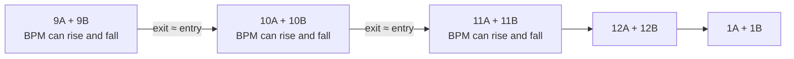

# Spotify Camelot Clusters

**Harmony defines the groups. BPM builds the path between them.**

A skill for sequencing playlists for Spotify Mix. It groups relative keys into Camelot clusters and finds a smooth tempo path within each group and across the transitions between them.

Developed from Vitor Ferreira’s sequencing method. The full assistant instructions are in [SKILL.md](SKILL.md), currently written in European Portuguese.

## The idea

Sorting by increasing BPM can place harmonically distant tracks next to each other. Sorting only by key can introduce large tempo jumps. This method follows a hierarchy:

1. **Group tracks by Camelot number**, combining A and B.
2. **Follow consecutive numbers around the wheel**, wrapping from 12 to 1.
3. **Plan the BPM path jointly**, including the entry and exit of each cluster.

The starting point depends on the available tracks. There is no requirement to start at 1 or 9. If a cluster is missing, the jump between the remaining groups should be identified.

### Why combine A and B?

In Camelot notation, A represents minor keys and B represents major keys. Matching numbers pair relative keys: **9A is E minor and 9B is G major**. Their natural scales share the same notes, but their tonal centers differ.

That relationship provides a basis for grouping the tracks. When moving to the next number, prefer the same letter when the tempo also allows it: for example, **9A → 10A** or **9B → 10B**. Diagonal moves that change both number and letter do not all offer the same harmonic compatibility.

## An example path

An illustrative sequence using fictional tracks:

| Cluster | Track | Camelot | Reported BPM | Equivalent BPM for the transition |
|---|---|---|---:|---:|
| 9 | A | 9A | 140 | 70 |
| 9 | B | 9B | 144 | 72 |
| 9 | C | 9A | 142 | 71 |
| 10 | D | 10A | 71 | 71 |
| 10 | E | 10B | 146 | 73 |

The first cluster follows **70 → 72 → 71**, then hands over to the next at **71 equivalent BPM**. The small drop prepares the transition; the tempo does not have to keep rising.

The reported BPM is retained. Treating **140 as equivalent to 70** compares the pulse in half-time/double-time; it does not alter the track or its key. The actual rhythmic feel still needs to be heard.

## What the skill guides

- Read the complete playlist and save its original order.
- Associate BPM and key with the correct version of each track.
- Build Camelot clusters and evaluate their entries, exits, and internal paths together.
- Balance transitions between groups with jumps inside them: a perfect bridge does not justify an avoidable jump in the middle of a cluster.
- Preserve tracks, versions, and existing repeated entries unless changes are explicitly requested.
- Apply the sequence and read back the complete playlist to verify the result.

Album, artist, and era do not determine blocks. The method also sets no universal BPM tolerance: small groups may offer limited options, and those limitations should be reported.

## How to use it

In an environment with the skill installed, ask:

> Use $spotify-camelot-clusters to organize this playlist. Use the BPM and keys shown by Spotify, create A/B clusters by number, and choose entry and exit tracks that connect the groups smoothly. Save the current order before applying changes and verify every track afterward.

Include the playlist link. If the skill is not installed, you can provide the assistant with a link to [SKILL.md](SKILL.md) and ask it to follow the instructions, provided the environment can read the file.

This repository contains **instructions for an assistant**, rather than a standalone application or Spotify extension. Reading and editing depend on the tools available in the session and access to your account. The skill itself does not grant access to Spotify or your computer.

## Where do BPM and key values come from?

The preferred reference is **the classification shown by Spotify itself**, when available for the exact track version.

An integration may be able to list and edit playlists without exposing BPM or key. In that case, values can be read from Spotify’s interface when visual access is available, or from screenshots supplied by the user. Hidden or unreadable rows do not count as collected data.

Early experiments used audio preview analysis, and incorrect classifications were identified. Therefore, **estimates must never be silently presented as Spotify data**. An experiment with incomplete data should state the sources, uncertainty, and tracks still awaiting confirmation.

## What to expect

A playlist with a clear harmonic structure, accompanied by the proposed sequence, data sources, and verification of the applied order.

Sequencing alone cannot resolve every transition:

- A track may change key or tempo.
- Similar BPM does not guarantee phrase alignment or suitable entry and exit points.
- Overlapping vocals and differences in energy can weaken a transition.
- Key classifications may differ between analyzers.

**Playlist verification confirms the order and preservation of tracks. Listening determines whether the transitions work.** The skill does not render audio or automatically configure Spotify Mix transitions.

If the available tool requires removing and reinserting tracks to change their order, their added dates may change. That effect should be explained before applying changes, and the previous order should be saved for recovery.

## Files

| File | Purpose |
|---|---|
| [SKILL.md](SKILL.md) | Sequencing method, data requirements, and application/verification workflow. |
| [agents/openai.yaml](agents/openai.yaml) | Display name, description, and example invocation. |

The repository contains no credentials, playlist exports, audio, or executable optimization engine.
