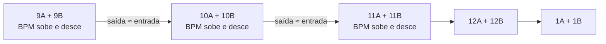

# Spotify Camelot Clusters

**A harmonia define os grupos. O BPM constrói o caminho entre eles.**

Um skill para organizar playlists destinadas ao Spotify Mix: reúne tonalidades relativas em clusters Camelot e procura um percurso de andamento fluido, tanto dentro de cada grupo como na passagem para o seguinte.

Desenvolvido a partir do método de Vitor Ferreira. As instruções completas para o assistente estão em [SKILL.md](SKILL.md).

## A ideia

Uma ordenação crescente por BPM pode aproximar faixas com tonalidades distantes. Ordenar apenas pelo tom pode criar saltos grandes de andamento. Este método estabelece uma hierarquia:

1. **Agrupar pelo número Camelot**, incluindo A e B.
2. **Percorrer os números da roda em sequência**, com passagem de 12 para 1.
3. **Escolher o percurso de BPM em conjunto**, incluindo a entrada e a saída de cada cluster.

O ponto de partida depende das faixas disponíveis. Não é obrigatório começar em 1 ou em 9. Se faltar um cluster, o salto entre os grupos existentes deve ficar identificado.

### Porque juntar A e B?

No sistema Camelot, A representa tonalidades menores e B tonalidades maiores. O mesmo número associa tonalidades relativas: **9A é Mi menor e 9B é Sol maior**, que partilham as notas das respetivas escalas naturais, mas têm centros tonais diferentes.

Esse parentesco permite organizar as faixas num grupo comum. Ao passar para o número seguinte, favorecer a mesma letra quando o andamento também o permitir: por exemplo, **9A → 10A** ou **9B → 10B**. Nem toda a passagem diagonal entre números e letras oferece a mesma compatibilidade.

## Um exemplo de percurso

Exemplo ilustrativo, com faixas fictícias:

| Cluster | Faixa | Camelot | BPM indicado | BPM equivalente para a ligação |
|---|---|---|---:|---:|
| 9 | A | 9A | 140 | 70 |
| 9 | B | 9B | 144 | 72 |
| 9 | C | 9A | 142 | 71 |
| 10 | D | 10A | 71 | 71 |
| 10 | E | 10B | 146 | 73 |

O primeiro cluster faz **70 → 72 → 71** e entrega o seguinte a **71 BPM equivalentes**. A pequena descida prepara a ligação; não existe uma obrigação de subir sempre.

O BPM indicado continua guardado. Usar **140 como equivalente a 70** é uma forma de comparar o pulso em half-time/double-time, não uma alteração à faixa nem à tonalidade. A sensação rítmica real precisa de ser ouvida.

## O que o skill orienta

- Recolher a playlist completa e guardar a ordem inicial.
- Associar BPM e tom à versão correta de cada faixa.
- Formar clusters Camelot e avaliar entradas, saídas e percursos internos em conjunto.
- Equilibrar as ligações entre grupos e os saltos internos: uma ponte perfeita não justifica um salto evitável no meio do cluster.
- Preservar faixas, versões e repetições existentes, salvo pedido explícito para as alterar.
- Aplicar a sequência e reler a playlist inteira para verificar o resultado.

Álbum, artista e época não determinam blocos. O método também não estabelece um limite universal de diferença de BPM: grupos pequenos podem ter poucas opções, e esses limites devem ser apresentados.

## Como utilizar

Num ambiente com o skill instalado, podes pedir:

> Usa $spotify-camelot-clusters para organizar esta playlist. Usa os BPM e tons apresentados pelo Spotify, cria clusters A/B por número e escolhe as entradas e saídas para ligar bem os grupos. Guarda a ordem atual antes de aplicar e verifica todas as faixas no fim.

Acrescenta a ligação da playlist. Se o skill ainda não estiver instalado, podes fornecer ao assistente a ligação para [SKILL.md](SKILL.md) e pedir que siga essas instruções, desde que o ambiente consiga ler o ficheiro.

Este repositório contém **instruções para um assistente**, não um programa autónomo ou uma extensão Spotify. A leitura e a edição dependem das ferramentas disponíveis na sessão e do acesso à tua conta. O skill, por si só, não concede acesso ao Spotify nem ao computador.

## De onde vêm os BPM e os tons?

A referência preferida é a **classificação apresentada pelo próprio Spotify**, quando disponível para a versão exata da faixa.

Uma integração pode conseguir listar e editar playlists sem expor BPM ou tom. Nesse caso, os valores podem ser recolhidos pela interface do Spotify, se houver acesso visual, ou por capturas fornecidas pelo utilizador. Linhas ocultas ou ilegíveis não contam como dados recolhidos.

O método foi inicialmente experimentado com análises de excertos; foram identificadas classificações erradas. Por isso, **estimativas não devem ser usadas silenciosamente como se fossem dados do Spotify**. Uma experiência com dados incompletos deve explicitar a origem, a incerteza e as faixas por confirmar.

## O que esperar do resultado

Uma playlist com uma estrutura harmónica clara, acompanhada pela sequência proposta, fontes dos valores e verificação da ordem aplicada.

Há limites que a ordenação não resolve por si só:

- Uma faixa pode mudar de tom ou de andamento.
- BPM próximos não garantem alinhamento de frases, entradas ou saídas.
- Vozes sobrepostas e diferenças de energia podem prejudicar uma transição.
- As classificações tonais podem divergir entre analisadores.

**A verificação da playlist confirma a ordem e a preservação das faixas. A audição confirma se as transições funcionam.** O skill não renderiza áudio nem configura automaticamente as transições do Spotify Mix.

Se a ferramenta disponível exigir remoção e reinserção para mudar a ordem, as datas de adição podem ser atualizadas. Esse efeito deve ser explicado antes da aplicação; a ordem anterior deve ficar guardada para recuperação.

## Ficheiros

| Ficheiro | Função |
|---|---|
| [SKILL.md](SKILL.md) | Método, critérios de dados e procedimento de aplicação/verificação. |
| [agents/openai.yaml](agents/openai.yaml) | Nome, descrição e exemplo de invocação apresentados ao utilizador. |

O repositório não inclui credenciais, exportações de playlists, áudio ou um motor de otimização executável.
